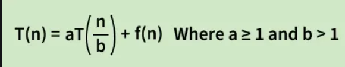

master theorem for divide and conquer recurrences 
the master theorem is a tool used to solve recurrence relations that arise in the analysis of divide and conquer algorithms. the theorem gives asymptotic bounds on tn in terms of standard notations. the master theorem provides a systematic way of solving recurrence relations of the following form.

where n is the size of the problem 
a>=1 is the number of subproblems
n/b is the size of each subproblem b>1
f(n) is the cost of work done outside the recursive calls [diivding the problem and combining results]
https://www.geeksforgeeks.org/dsa/advanced-master-theorem-for-divide-and-conquer-recurrences/