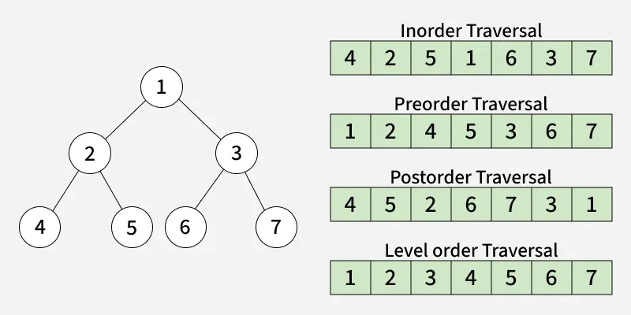
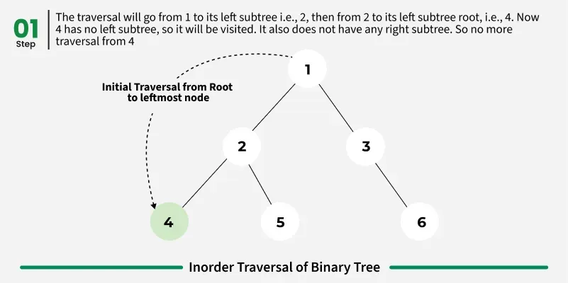
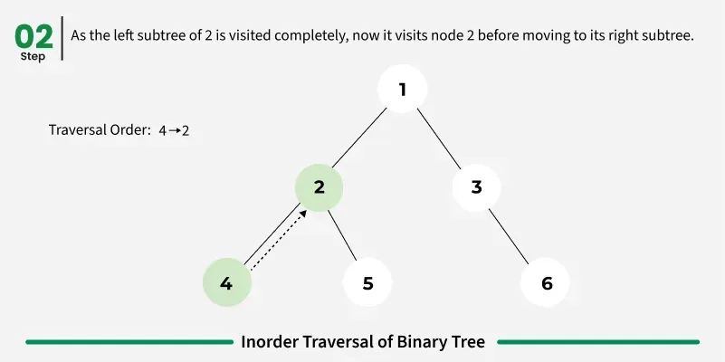
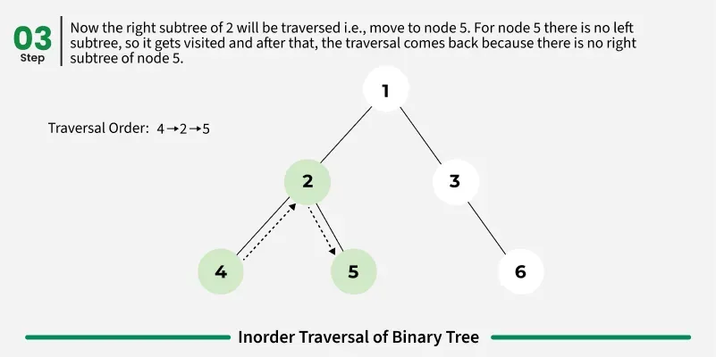
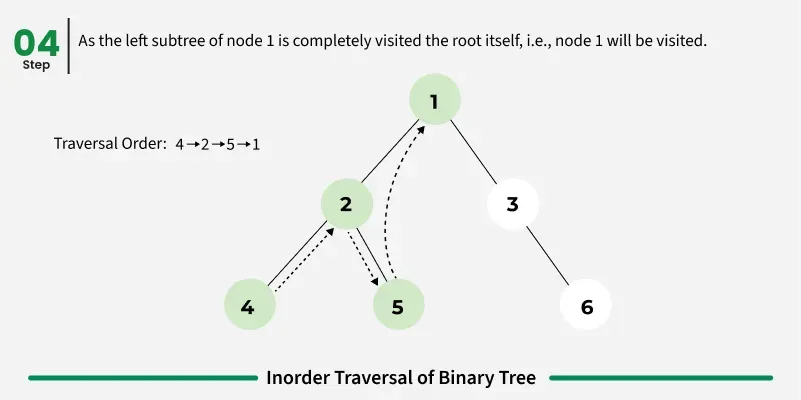
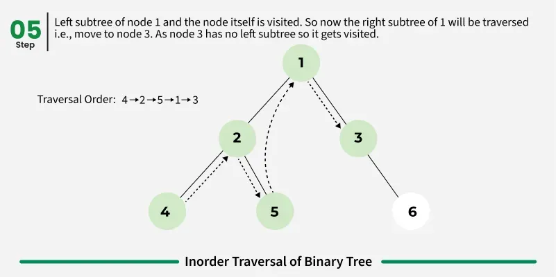
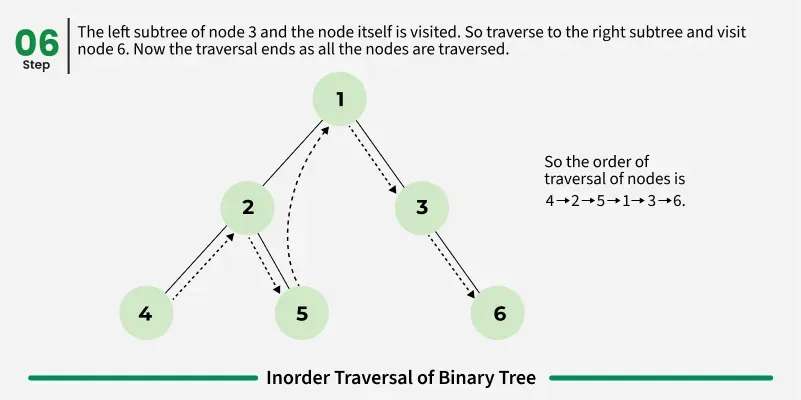

Tree traversal refers to the process of visiting or accessing each node of a tree exactly once in a specific order. Unlike linear data structures such as arrays, linked lists, or queues (which have only one logical way of traversal), trees offer multiple ways to traverse their nodes. 

tree traversals are broadly classified into two categories
1. depth first traversal 
2. breath first traversal [level order traversal or BFS]

the depth first traversal include inorder traversal, preorder traversal, post order traversal

depth first traversal DFT
- explores as far as possible along a branch before exploring the next branch
- types - inorder, preorder, post order

breath first traversal BFT
- explores nodes level by level from top to bottom
- type level order traversal 

inorder traversal - inorder traversal visits the node in order left->root->right

algorithm for inorder traversal 
inorder tree 
- traverse the left subtree call inorder (left -> subtree)
- visit the root
- traverse the right subtree call inorder (right -> subtree)

