Tree traversal refers to the process of visiting or accessing each node of a tree exactly once in a specific order. Unlike linear data structures such as arrays, linked lists, or queues (which have only one logical way of traversal), trees offer multiple ways to traverse their nodes. 

tree traversals are broadly classified into two categories
1. depth first traversal 
2. breath first traversal [level order traversal or BFS]

the depth first traversal include inorder traversal, preorder traversal, post order traversal

depth first traversal DFT
- explores as far as possible along a branch before exploring the next branch
- types - inorder, preorder, post order

breath first traversal BFT
- explores nodes level by level from top to bottom
- type level order traversal 

inorder traversal - inorder traversal visits the node in order left->root->right

algorithm for inorder traversal 
inorder tree 
- traverse the left subtree call inorder (left -> subtree)
- visit the root
- traverse the right subtree call inorder (right -> subtree)

uses of inorder traversal 
- in the case of binary search tree [bst], inorder traversal gives nodes in non decreasing order.
- to get nodes of bst in non increasing order, a variation of inorder traversal where inorder traversal is reversed can be used.
- inorder traversal can be used to evaluate arithmetic expressions stored in expression trees. 

preorder traversal - preorder traversal visits the node in the order : root -> left -> right
algorithm for preorder traversal 
preorder[tree] 
- visit the root.
- traverse the left subtree call preorder [left->subtree]
- traverse the right subtree call preorder[right->subtree]
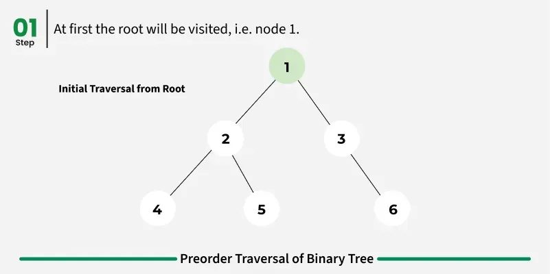
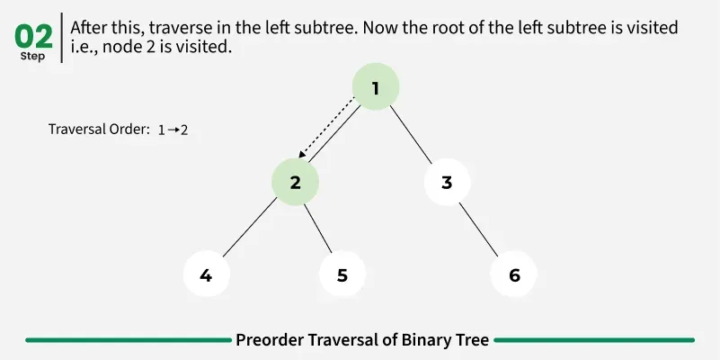
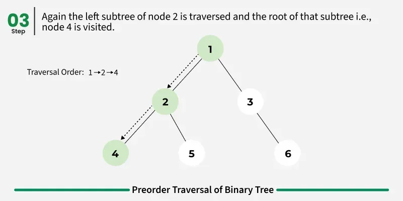
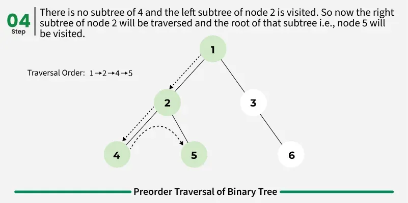
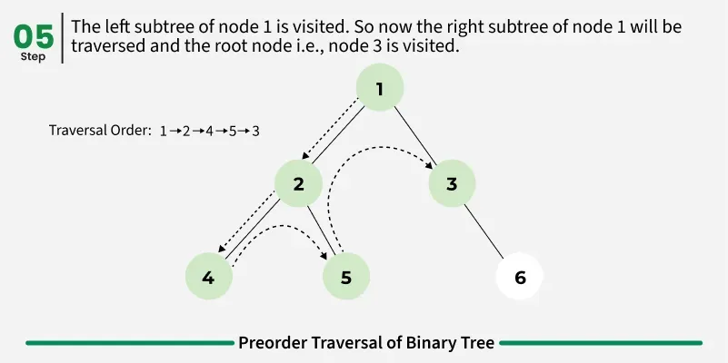
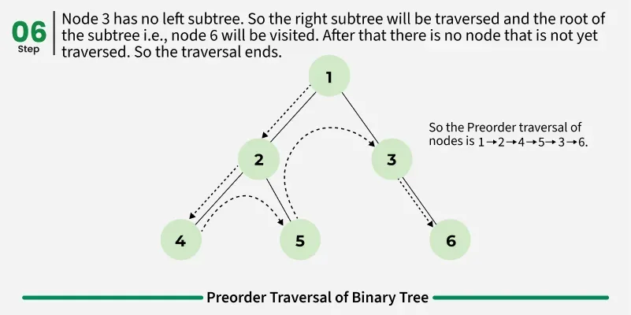

use of preorder traversal 
- preorder traversal is used to create a copy of the tree
- preorder traversal is also used to get prefix expressions on an expression tree.

postorder traversal - visits the node in the order left->right->root
algorithm for postorder traversal 
- traverse the left subtree call postorder[left->subtree]
- traverse ther right subtree call postorder[right->subtree]
- visit the root

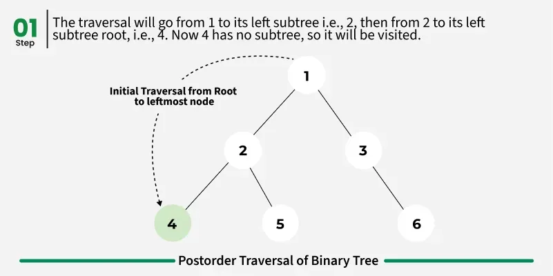
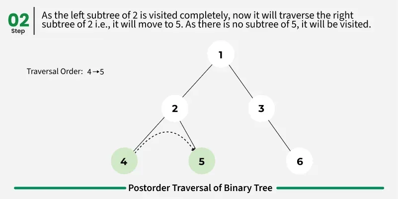
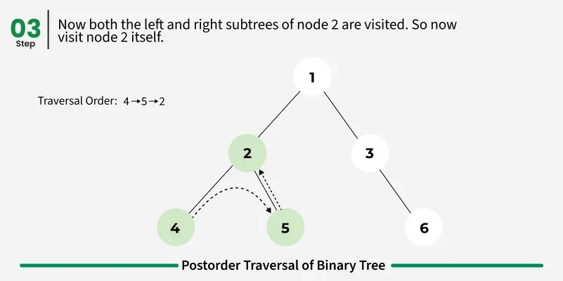
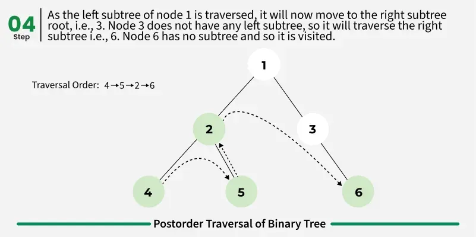
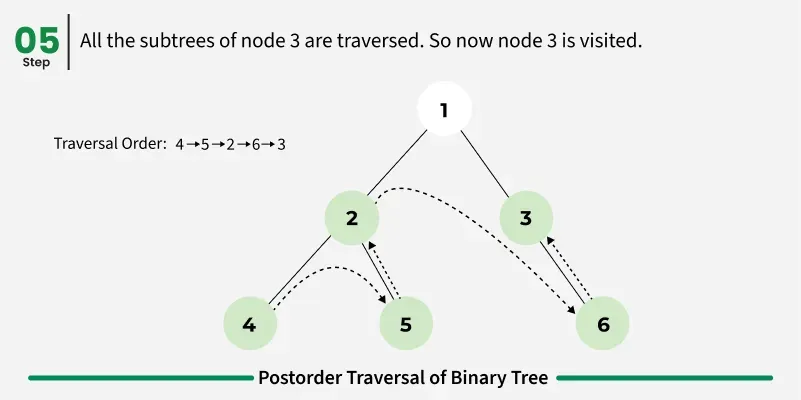
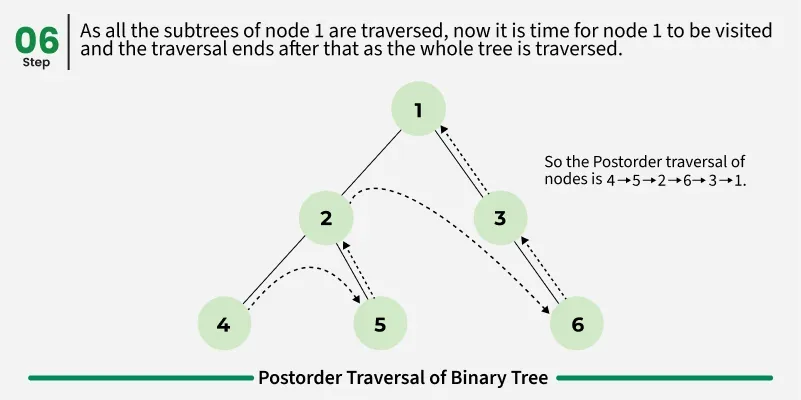

uses of post order traversal
- postorder traversal is used to delete the tree
- postorder traversal is also useful to get the postfix expression of an expression tree.
- post order traversal can help in garbage collection algorithms, particularly in systems where manual memory management is used.

level order traversal - visits all nodes present in the same level completely before visiting the next level.
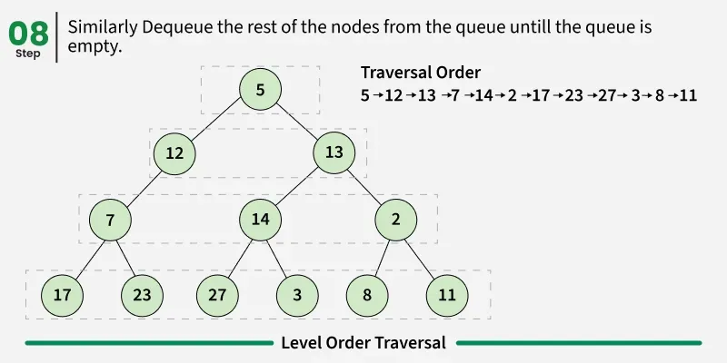

algorithm for level order traversal 
level order[tree]
- create an empty queue q
- enqueue the root node of the three to q
- loop while q is not empty 
    - dequeue a node from q and visit it 
    - enqueue the left child of the dequeued node if it exists
    - enqueue the right child of the dequeued node if it exists. 

uses of level traversal 
1. level wise node processing, like finding maximum/minimum at each level.
2. tree serialization/deserialization for efficient storage and reconstruction.
3. solving problems like calculating the "maximum width of a tree" by processing nodes level by level.

other tree traversals 
1. boudry traversal 
2. diagonal traversal 

1. boundry traversal - boundry traversal of a tree includes
- left boundry [nodes of left excluding lead nodes]
- elaves [consist of only the leaf nodes]
- right boundry [nodes on right excluding leaf nodes]

2. diagonal traversal - all the nodes in a single diagonal will be printed one by one 
